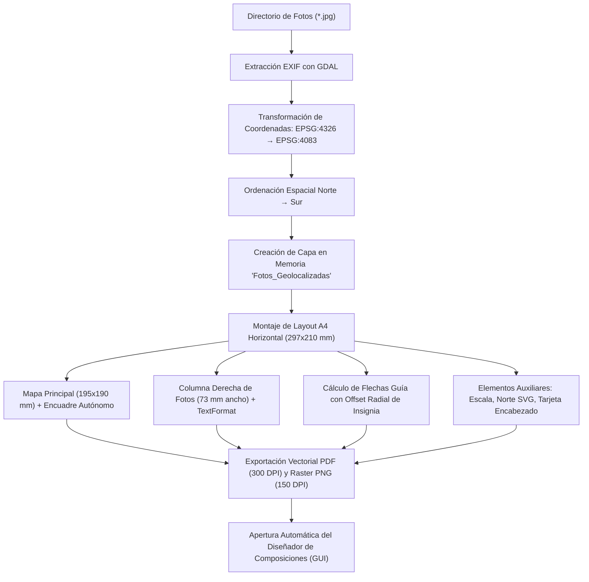

# Guía y Documentación: Utilidad de Localización Fotográfica y Flechas en Mapa (PyQGIS)

**Fecha:** 2026-10-22 / 2026-11-09  
**Proyecto:** Plan General de Ordenación - Santa Cruz de Tenerife  
**Ubicación:** `c:/dev/QGIS-testing`  
**Script Principal:** [`qgis_create_photo_layout.py`](file:///c:/dev/QGIS-testing/QGIS_scripts/qgis_create_photo_layout.py)  
**Directorio de Fotos:** [`Photos-1-001`](file:///c:/dev/QGIS-testing/QGIS_projects/Santa%20Cruz%20de%20Tenerife/Photos-1-001)  

---

## 1. Resumen Ejecutivo y Objetivo

Esta utilidad automatiza la lectura de fotografías geolocalizadas desde cualquier carpeta, extrayendo sus metadatos EXIF (coordenadas GPS y fecha/hora), proyectándolas en el mapa del proyecto y generando una composición de impresión en formato **A4 Horizontal (297 × 210 mm)** con:

1. **Mapa Cartográfico Principal:** Encuadrado automáticamente en el ámbito de trabajo y las fotos, con marco arquitectónico, escala gráfica y flecha de norte.
2. **Capa Vectorial de Marcadores en Mapa (`Fotos_Geolocalizadas`):** Pines circulares con distintivo magenta (`#D81B60`) y numeración blanca en negrita centrada.
3. **Columna Lateral Derecha de Fotografías:** Marco proporcional, encuadre limpio y pie descriptivo con nombre de archivo, coordenadas geográficas y fecha de captura.
4. **Flechas Guía Anti-Cruces (Leader Lines):** Polilíneas directas con quiebro estilizado y punta de flecha calculada para posarse con precisión en el borde exterior del pin correspondiente, evitando superposiciones.

---

## 2. Flujo Técnico y Arquitectura de la Solución



### 2.1. Extracción de Metadatos EXIF mediante GDAL (`extract_photos_metadata`)
- Utiliza la librería nativa [`osgeo.gdal`](file:///c:/dev/QGIS-testing/QGIS_scripts/qgis_create_photo_layout.py#L16), presente en todas las instalaciones de QGIS / OSGeo4W, eliminando cualquier dependencia de librerías externas de terceros (como `Pillow` o `piexif`).
- Procesa cadenas DMS (`EXIF_GPSLatitude`, `EXIF_GPSLongitude`) y aplica la corrección de hemisferio negativo para latitudes `S` y longitudes `W` mediante [`parse_dms`](file:///c:/dev/QGIS-testing/QGIS_scripts/qgis_create_photo_layout.py#L74).
- Extrae la resolución nativa en píxeles (`width_px`, `height_px`) para conservar la relación de aspecto panorámico original.

### 2.2. Reproyección Cartográfica
- Las coordenadas GPS se capturan en WGS 84 (`EPSG:4326`) y se re-proyectan dinámicamente al CRS activo del proyecto (`EPSG:4083` REGCAN95 / UTM zone 28N) mediante [`QgsCoordinateTransform`](file:///c:/dev/QGIS-testing/QGIS_scripts/qgis_create_photo_layout.py#L102).

### 2.3. Estrategia de Ordenación Anti-Cruces
- Las fotos se ordenan de mayor a menor latitud (**Norte a Sur**).
- Al situar las fotos ordenadas de arriba a abajo en la columna derecha, las líneas que se dirigen a las parcelas del mapa se mantienen alineadas paralelamente, erradicando cruces visuales entre flechas contiguas.

### 2.4. Capa Vectorial de Marcadores en Memoria (`create_or_update_points_layer`)
- Genera una capa temporal [`QgsVectorLayer`](file:///c:/dev/QGIS-testing/QGIS_scripts/qgis_create_photo_layout.py#L153) con campos `id`, `foto`, `lat`, `lon`.
- Simbología: [`QgsSimpleMarkerSymbolLayer`](file:///c:/dev/QGIS-testing/QGIS_scripts/qgis_create_photo_layout.py#L175) circular de `7.0 mm`, color magenta `#D81B60` y borde blanco `#FFFFFF` de `0.7 mm`.
- Etiquetado: [`QgsPalLayerSettings`](file:///c:/dev/QGIS-testing/QGIS_scripts/qgis_create_photo_layout.py#L187) centrado sobre el punto ([`Qgis.LabelPlacement.OverPoint`](file:///c:/dev/QGIS-testing/QGIS_scripts/qgis_create_photo_layout.py#L189)) con tipografía `Arial 8 pt Negrita` blanca.
- Se inserta en la posición `0` del árbol de capas para asegurar visibilidad total sobre ortofotos y capas de zonificación.

### 2.5. Composición del Layout (`build_photo_layout`)
- **Tamaño de página:** A4 Horizontal (`297 × 210 mm`).
- **Encuadre Autónomo:** Si existe extensión activa del canvas la respeta; de lo contrario, combina la caja delimitadora del polígono de interés ([`TARGET_POLYGON_CODE`](file:///c:/dev/QGIS-testing/QGIS_scripts/qgis_create_photo_layout.py#L71) = `5874-821-SU-1-2-1_381_377`) y las coordenadas de las fotos con un margen de amortiguación de `160 m`.
- **Cálculo de Flechas con Desplazamiento Radial (Offset):**
  - Origen: Punto medio lateral izquierdo de la foto (`col_x`, `photo_mid_y`).
  - Quiebro intermedio: Tramo horizontal de `6 mm` hacia el interior del mapa para mejorar la legibilidad.
  - Destino: Transforma las coordenadas geográficas al papel mediante [`map_item.mapToItemCoords()`](file:///c:/dev/QGIS-testing/QGIS_scripts/qgis_create_photo_layout.py#L370).
  - **Fórmula de parada radial:** Calcula el vector director hacia el centro de la insignia y detiene la punta de la flecha a una distancia exacta de `4.0 mm` del centro, garantizando que la punta toque la circunferencia sin tapar el número.
- **Tipografía y Estilo Moderno:** Uso de [`QgsTextFormat`](file:///c:/dev/QGIS-testing/QGIS_scripts/qgis_create_photo_layout.py#L206) estructurado, eliminando advertencias de desuso (*deprecation warnings*).
- **Elementos Auxiliares:**
  - Tarjeta de título con fondo blanco translúcido (`rgba(255, 255, 255, 230)`).
  - Escala gráfica de caja única (`QgsLayoutItemScaleBar`) configurada en metros.
  - Flecha de norte vectorial SVG (`arrows/NorthArrow_02.svg`) vinculada a la rotación del mapa.

---

## 3. Parámetros de Configuración del Script

En la cabecera de [`qgis_create_photo_layout.py`](file:///c:/dev/QGIS-testing/QGIS_scripts/qgis_create_photo_layout.py#L63-L73) pueden modificarse las siguientes constantes:

| Constante | Valor por Defecto | Descripción |
| :--- | :--- | :--- |
| `DEFAULT_PHOTOS_DIR` | `c:\dev\QGIS-testing\QGIS_projects\Santa Cruz de Tenerife\Photos-1-001` | Directorio con las fotografías geolocalizadas (`.jpg`, `.jpeg`). |
| `DEFAULT_PROJECT_PATH` | `c:\dev\QGIS-testing\QGIS_projects\Santa Cruz de Tenerife\Santa Cruz de Tenerife.qgz` | Archivo del proyecto QGIS para ejecución standalone. |
| `DEFAULT_OUTPUT_PDF` | `c:\dev\QGIS-testing\QGIS_projects\Santa Cruz de Tenerife\Plano_Fotografias.pdf` | Ruta de exportación del plano en formato PDF vectorial (300 DPI). |
| `DEFAULT_OUTPUT_PNG` | `c:\dev\QGIS-testing\QGIS_projects\Santa Cruz de Tenerife\Plano_Fotografias.png` | Ruta de exportación de la previsualización rasterizada (150 DPI). |
| `DEFAULT_LAYOUT_NAME` | `"Reporte_Fotografias"` | Nombre asignado a la composición en el Administrador de Diseños. |
| `TARGET_POLYGON_CODE` | `"5874-821-SU-1-2-1_381_377"` | Código de la parcela de interés en la capa `CLA` para encuadre automático. |

---

## 4. Entregables y Recursos

| Recurso | Enlace / Ruta | Descripción |
| :--- | :--- | :--- |
| **Script Principal** | [`qgis_create_photo_layout.py`](file:///c:/dev/QGIS-testing/QGIS_scripts/qgis_create_photo_layout.py) | Generador integral de la capa de pines y el layout fotográfico. |
| **Plano PDF (300 DPI)** | [`Plano_Fotografias.pdf`](file:///c:/dev/QGIS-testing/output/Plano_Fotografias.pdf) | Salida vectorial lista para impresión y entrega técnica. |
| **Plano PNG (150 DPI)** | [`Plano_Fotografias.png`](file:///c:/dev/QGIS-testing/output/Plano_Fotografias.png) | Imagen rasterizada de alta fidelidad para consulta rápida. |
| **Carpeta de Fotografías** | [`Photos-1-001`](file:///c:/dev/QGIS-testing/QGIS_projects/Santa%20Cruz%20de%20Tenerife/Photos-1-001) | Conjunto de fotos de campo con metadatos EXIF GPS integrados. |

---

## 5. Guía de Ejecución Rápida

### Opción A: Desde la Interfaz Gráfica de QGIS (Recomendado)
1. Abrir el proyecto en QGIS Desktop (`Santa Cruz de Tenerife.qgz`).
2. Abrir la consola Python (`Ctrl + Alt + P`).
3. Ejecutar el script:
   ```python
   exec(open(r"C:\dev\QGIS-testing\QGIS_scripts\qgis_create_photo_layout.py").read())
   ```
4. El Diseñador de Composiciones se abrirá automáticamente con el plano renderizado listo para exportación o edición interactiva.

### Opción B: Modo Desatendido / CLI (PowerShell)
Ejecutar mediante el entorno de Python de OSGeo4W sin necesidad de tener abierta la ventana gráfica de QGIS:
```powershell
& C:\OSGeo4W\bin\python-qgis-ltr.bat C:\dev\QGIS-testing\QGIS_scripts\qgis_create_photo_layout.py
```
El script reportará el progreso paso a paso por consola y generará los archivos en las rutas indicadas.
